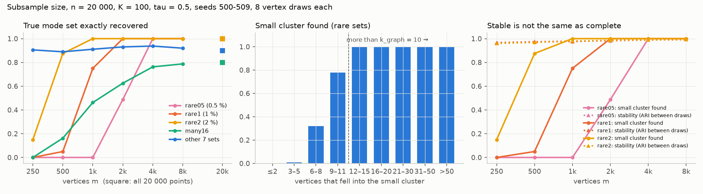
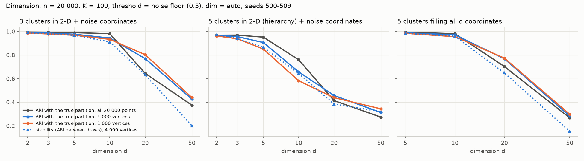
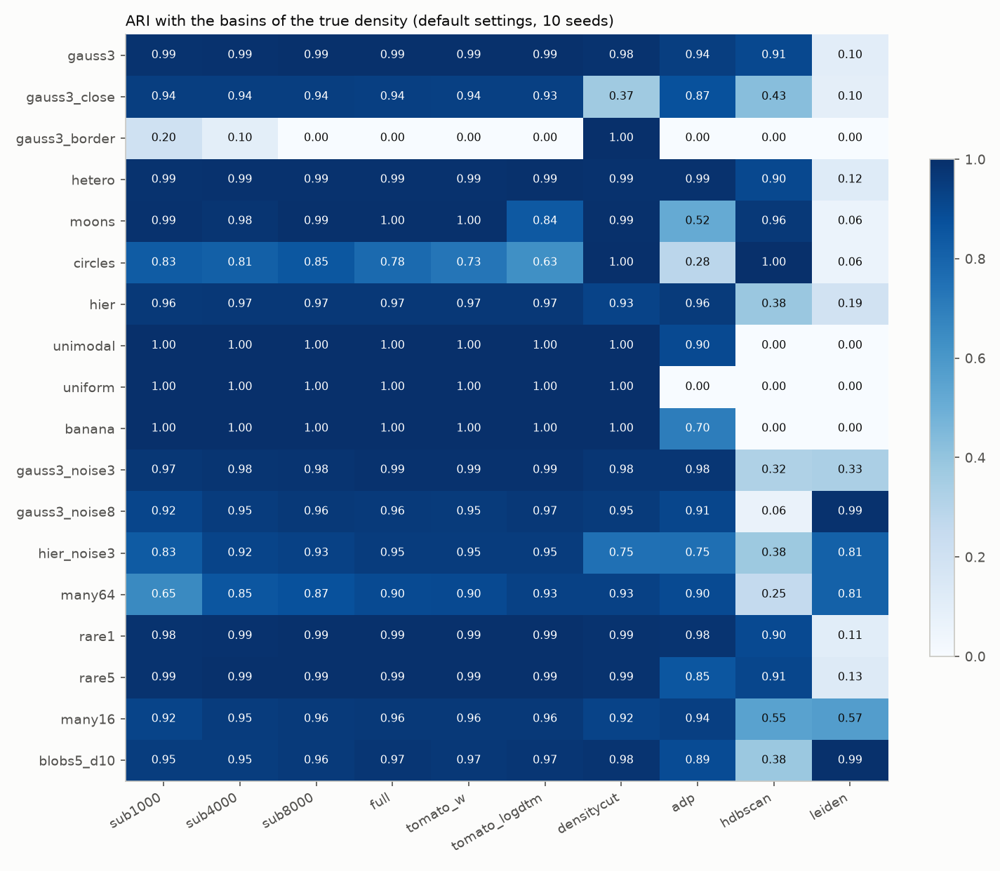
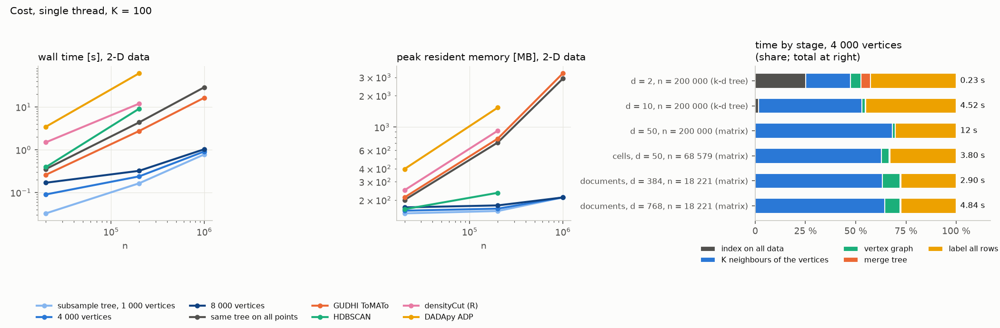
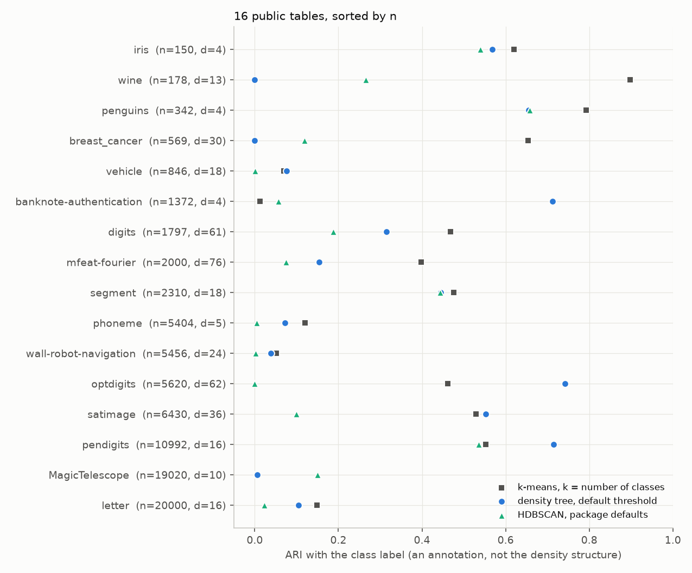
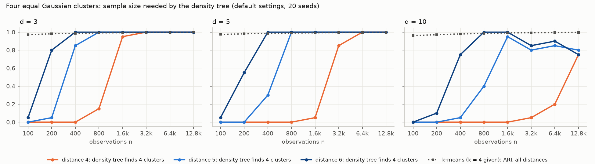

# Phase A report

Question of this phase: after two selective-refinement designs failed to beat
it, is the plain **uniform subsample density cluster tree** a sound basis for a
research software package in R and Python (ATDC), and what should that package
promise?

The estimator (`src/atdc/subsample.py`): m rows drawn uniformly become graph
vertices; each gets the kNN log-density computed against all n rows (K
neighbours); the merge tree of that density on the kNN graph of the vertices
is pruned at a prominence threshold τ; every row takes the label of its
nearest vertex. It is ToMATo on a subsample with full-data densities; nothing
in it is new.

Companion documents: [`phaseA_spec_draft.md`](phaseA_spec_draft.md) (common
specification, draft 0.1), [`phaseA_api.md`](phaseA_api.md) (architecture, R
and Python APIs, conformance plan), [`phaseA_software_survey.md`](phaseA_software_survey.md)
(existing software, literature, SoftwareX requirements).

## 0. Summary

| Question | Answer | Where |
|---|---|---|
| Does subsampling lose accuracy? | No, from about 4 000 vertices: exact recovery of the true modes 0.86 against 0.84 with all 20 000 points; ARI 0.960 against 0.959. | §1 |
| What does it lose? | Clusters into which 10 vertices or fewer fall. A 0.5 % cluster needs m ≥ 4 000, a 1 % cluster m ≥ 2 000. The loss is silent and perfectly stable under resampling. | §1 |
| Up to which dimension? | Reliable to d ≈ 5, usable at d ≈ 10, unusable from d ≈ 20 when the extra coordinates carry noise — with all points as well as with a subsample. | §2 |
| Against existing tools, same reference? | Same partition quality as ToMATo (GUDHI) by construction; far above HDBSCAN defaults; level with densityCut, each ahead on different data (ARI 0.91 vs 0.93 over 18 sets; 0.96 vs 0.93 without the one set built to be undecidable). | §3 |
| Cost? | A million rows in 2-D: 0.9 s and 0.2 GB, against 16 s and 3.3 GB for ToMATo on all points. Real data (18 000–69 000 rows, 50–768 dimensions): 3–5 s against 2–7 minutes for ToMATo, HDBSCAN, densityCut. The merge tree itself takes 0.01 s. Approximate neighbour search does not pay and is dropped. | §4 |
| R and Python agree? | An R prototype written from the description reproduces the Python reference exactly in 15 of 15 configurations (densities to 9e-14; identical graph, peaks, labels). Speed: equal in low dimension, R two to three times slower from ten dimensions. | §4 |
| Does it serve "check a k-means result"? | Rarely. It needs about 400–1 600 rows for four clear clusters in 3–5 dimensions, more in 10; below that it reports one cluster where k-means is right. On 16 public tables the comparison confirmed the k-means partition on 2, contradicted it on 1 and could say nothing on 13 — the same after reduction to 10 or 5 principal components. | §5 |
| On public tables? | n ≥ 2 000 (9 sets): ARI with the class label 0.31, k-means given the true k 0.31, HDBSCAN defaults 0.15. n < 2 000 (7 sets): 0.33, 0.50, 0.26. | §5 |
| On embeddings and expression data? | As given (50–384 dimensions): unstable, ARI 0.11–0.15 against 0.31–0.38 for k-means. After reduction to 5–10 dimensions: stable, level with or above HDBSCAN, still at or below k-means. | §5 |
| Is there such a package already? | No package found that offers this tree with prominence and stability diagnostics, a comparison with an existing partition, and the same analysis in R and Python. Every ingredient exists separately. `atdc` is free on PyPI and CRAN. | §6 |

**Judgement: the software is sound; the purpose stated for it is not
supported. GO only if the purpose is restated** (§10).

What holds: the estimator is as accurate as ToMATo, one to two orders of
magnitude cheaper at scale, gives identical results in R and Python, and no
existing package offers it with its diagnostics in both languages. It works
where density trees work at all: at least about a thousand rows and an
intrinsic dimension of about ten or less.

What does not hold is the use case the plan puts first — answering the
criticism that the number of clusters of a k-means analysis is arbitrary:

1. **On typical tables the comparison is uninformative.** 13 of 16 public
   tables: the tree could not have confirmed the k-means clusters even if they
   were ideal Gaussian clusters (§5.4). A density tree needs 100–400 rows per
   cluster and few dimensions; k-means needs neither.
2. **Embeddings and expression data as given** are outside the working regime
   of every density tree (this one, ToMATo, HDBSCAN); after reduction the tree
   is level with HDBSCAN and at or below k-means in agreement with the
   annotation (§5.3).

These are limits of density-based clustering, not of subsampling or of the
implementation, and no feature added in later phases removes them. A package
is worth building as *a fast density cluster tree with diagnostics for large
low-dimensional data, in R and Python*; it is not worth building as *a
validator of k-means analyses*.

## Protocol

* Data seeds: `default_rng(1000 + seed)`. Development seeds 400–404, reporting
  seeds 500–509 (500–519 for §5.2), 700–702 for cost, 811–815 for the
  controlled cases of §5.4; none used in Phases 1–2. Vertex draws use
  separate seed sequences.
* Chosen on development seeds and then fixed: no edge check, `k_graph = 10`
  (§1); `dim = "auto"` (§2); stability threshold 0.8 (§5).
* The stability rule was changed twice while looking at the 16 public tables
  (§5.1); its numbers on those tables are development results. Its behaviour
  on reporting seeds is in §2 and §5.2.
* Wall times: one process per run, single thread, nothing else running
  (`16_cost.py`, `14_cross_language.py`). All other scripts ran in parallel
  and their times are not reported.
* Competitors run through their own packages: GUDHI 3.13 (`Tomato`), hdbscan,
  DADApy 0.3.4 (separate numpy < 2 environment), densitycut 0.0.1 (R, from its
  Bitbucket repository), leidenalg. AuToMATo was not rerun in this phase (its
  Phase-1 run at n = 5 000 stands; it needs minutes per fit).
* Every table below is produced by `benchmarks/18_report_A.py` from
  `results/raw/1[2-9]_*.csv`, `20_*.csv`, `21_*.csv` into `results/summary/A_*.csv`.

## 1. Subsample size (`12_subsample.py`)

n = 20 000, K = 100, τ = 0.5, 12 data sets × 10 seeds × 8 vertex draws; "all"
is the same estimator with every point as a vertex. Ground truth: modes of the
true density with log-prominence ≥ 0.5 and their basins.

| m | exact modes | missed modes per run | extra | ARI | merge-order recall | smallest cluster found | stability between draws |
|---|---|---|---|---|---|---|---|
| 250 | 0.54 | 5.22 | 0.06 | 0.863 | 0.40 | 0.56 | 0.863 |
| 500 | 0.61 | 4.00 | 0.08 | 0.894 | 0.56 | 0.66 | 0.891 |
| 1 000 | 0.72 | 1.98 | 0.07 | 0.931 | 0.70 | 0.76 | 0.922 |
| 2 000 | 0.80 | 0.92 | 0.05 | 0.953 | 0.81 | 0.84 | 0.948 |
| 4 000 | 0.86 | 0.66 | 0.05 | 0.960 | 0.88 | 0.90 | 0.963 |
| 8 000 | 0.85 | 0.59 | 0.06 | 0.960 | 0.88 | 0.90 | 0.970 |
| all (20 000) | 0.84 | 0.54 | 0.07 | 0.959 | 0.89 | 0.90 | — |

* **From m = 4 000 the subsample tree is as good as the full one.** What
  remains wrong at that point is wrong with all points too: `many64` (64
  clusters, 312 points each with K = 100: 57.7 of 64 modes found with all
  points, 56.3 with 4 000 vertices) and `circles` (extra peaks on the ring).
  These are limits of the bandwidth, not of the subsample.
* **Small clusters need vertices, and the number is predictable.** With
  `k_graph = 10`, a cluster was found in 0 % of the runs when 2 or fewer
  vertices fell into it, 1 % with 3–5, 32 % with 6–8, 78 % with 9–11, and
  100 % with 12 or more (1 720 runs). In terms of the expected number m·π:
  below 6 never, 9–12 in 75 %, above 12 always. Hence the resolution rule of
  the specification: a share of about 12/m is the smallest that is found
  reliably — 0.3 % at m = 4 000.
* **Stability does not reveal the loss.** For the 0.5 % cluster at m = 1 000
  the cluster is missed in every run, the ARI between two draws is 0.98, and
  in the half of the runs where doubling m leaves the count unchanged it is
  still missed in every one. A stability diagnostic can certify that a
  partition is reproducible; it cannot certify that it is complete.
* A doubling rule (start at 1 000, double m until count and partition stop
  changing) ends at m = 2 070 on average with 0.82 exact recovery; simply
  using 4 000 gives 0.86. **Default: m = min(n, 4 000)**, with the resolution
  printed; the comparison with 2m stays available as a check.
* Development variants (seeds 400–404): `k_graph = 5` finds smaller clusters
  but adds 0.5–0.8 false modes per run; `k_graph = 20` loses modes; capping
  every edge by the density at its midpoint helps at small m (0.78 against
  0.72 exact at m = 1 000) at 6× the density evaluations, and is beaten by
  plain m = 8 000 at the same cost (0.86). None is adopted.
* The saddle error is not monotone in m (0.53 at m = 2 000, 0.87 with all
  points): the merge level is a maximum over paths and its upward bias grows
  with the number of vertices. Heights of saddles should be reported as
  graph quantities (specification §7.3).

## 2. Dimension (`13_dimension.py`)

n = 20 000, K = 100, threshold = noise floor, `dim = "auto"`, 10 seeds, 4
vertex draws. ARI with the true partition; "stab." is the ARI between two
vertex draws (m = 4 000).

| Data | d | all points | m = 4 000 | m = 1 000 | stab. | clusters found (true) |
|---|---|---|---|---|---|---|
| 3 clusters in 2-D + noise coordinates | 2 | 0.99 | 0.99 | 0.99 | 0.99 | 3.0 (3) |
| | 5 | 0.99 | 0.98 | 0.97 | 0.97 | 3.0 |
| | 10 | 0.98 | 0.94 | 0.93 | 0.91 | 3.2 |
| | 20 | 0.64 | 0.77 | 0.80 | 0.63 | 5.1 |
| | 50 | 0.38 | 0.43 | 0.44 | 0.20 | 6.6 |
| 5 clusters in 2-D (hierarchy) + noise | 2 | 0.97 | 0.97 | 0.96 | 0.97 | 5.0 (5) |
| | 5 | 0.95 | 0.91 | 0.85 | 0.86 | 4.9 |
| | 10 | 0.76 | 0.66 | 0.58 | 0.64 | 4.3 |
| | 20 | 0.41 | 0.46 | 0.44 | 0.38 | 6.2 |
| | 50 | 0.27 | 0.31 | 0.34 | 0.32 | 7.4 |
| 5 clusters filling d dimensions | 5 | 0.99 | 0.99 | 0.98 | 0.98 | 5.0 (5) |
| | 10 | 0.98 | 0.97 | 0.96 | 0.96 | 5.1 |
| | 20 | 0.70 | 0.77 | 0.77 | 0.65 | 7.8 |
| | 50 | 0.27 | 0.28 | 0.30 | 0.15 | 6.4 |

* Up to d = 5 the tree is right; at d = 10 clear clusters are still found and
  shallow ones are lost (the hierarchy: 0.66–0.76); from d = 20 the partition
  is wrong **with all points as well** — more vertices do not help, they add
  spurious peaks (14.9 clusters instead of 3 with all points at d = 50).
* No threshold repairs d = 50: the best threshold in hindsight gives ARI
  0.27–0.47. At d = 20 a higher threshold would help (0.83–0.95 at τ ≈ 0.7–1.0
  against 0.64–0.77 at the floor): the noise floor, derived from the variance
  of one density estimate, is too low in high dimension, where the error is
  dominated by the graph and not by that variance.
* The stability diagnostic follows the failure (0.15–0.65 where the partition
  is wrong, ≥ 0.86 where it is right), and with the rule "finest threshold
  with stability ≥ 0.8" the answer degrades gracefully: the correct clusters
  up to d = 10 for clear clusters, the two super-clusters of the hierarchy at
  d = 10–20, and "no stable partition" at d = 50
  (`A_13_stable_threshold.csv`).
* `dim = "auto"` (Levina–Bickel estimate from the distances already computed;
  it returns 2.0, 4.9, 8.9, 15, 27 for true dimensions 2, 5, 10, 20, 50) gives
  the same results as the ambient dimension up to d = 10 and fewer spurious
  clusters above (14.9 against 27.6 at d = 50). It also makes prominences of
  data with low intrinsic dimension comparable to the noise floor: for the
  384-d embeddings it returns 22, for the 50 principal components 17. Adopted
  as the default.
* These data are the hardest case — the added coordinates have the same
  variance as the signal. A reduction that removes them restores the low-d
  result; the software cannot do that for the user but must say so.

## 3. Existing tools (`15_competitors_A.py`)

n = 20 000, 18 data sets × 10 seeds. Reference: basins of the true density at
τ = 0.5, which is the target of the first three rows by construction. For the
others the table says how far a different definition lands from it.

| Method | Target | number of clusters right | ARI | unlabelled | best setting per data set: ARI |
|---|---|---|---|---|---|
| subsample tree, m = 8 000 | same | 0.82 | 0.911 | 0 | — (fixed) |
| subsample tree, m = 4 000 | same | 0.81 | 0.909 | 0 | — |
| subsample tree, m = 1 000 | same | 0.78 | 0.895 | 0 | — |
| same tree, all points | same | 0.81 | 0.910 | 0 | — |
| GUDHI ToMATo, same density supplied | same | 0.76 | 0.908 | 0 | — |
| GUDHI ToMATo, its default logDTM density | near | 0.77 | 0.896 | 0 | — |
| densityCut (R), defaults | other | 0.87 | 0.931 | 0 | 0.931 |
| DADApy ADP, Z = 1.65 (default) | other | 0.48 | 0.743 | 0 | 0.899 (Z = 3) |
| HDBSCAN, min_cluster_size n/100 | other | 0.47 | 0.464 (0.659 on labelled points) | 27 % | 0.543 |
| Leiden, 15-NN graph, resolution 1 | other | 0.11 | 0.299 | 0 | 0.525 |

* **Against ToMATo** the subsample tree is the same estimate at lower
  resolution, and at m = 4 000 nothing is lost. (GUDHI differs slightly from
  our full tree because it follows the directed neighbour lists; ours uses the
  symmetrised graph.)
* **densityCut is level with the tree, and ahead on the mean** (0.931
  against 0.909). The whole difference comes from `gauss3_border`, a data set
  built in Phase 1 to be undecidable at this threshold (true prominence
  0.40–0.45 against τ = 0.5): densityCut returns one cluster there (ARI 1.00),
  every tree method two or three (ARI 0.0–0.2). Without that set the means are
  0.927 for densityCut and 0.957 for the tree at m = 4 000
  (`A_15_with_without_border.csv`; this split was looked at after the
  results, so both numbers are given and neither is the headline). Set by
  set: densityCut is ahead on `circles` (1.00 against 0.81) and `many64`
  (0.93 against 0.85); the tree is ahead where modes are close or sit on a
  hierarchy (`gauss3_close` 0.94 against 0.37, `hier_noise3` 0.92 against
  0.75). densityCut exists only as an R package on Bitbucket, last changed in
  2016. It is the closest competitor in quality and the report does not claim
  to beat it.
* **HDBSCAN** answers a different question (it leaves 27 % of the points
  unlabelled and optimises excess of mass); on unimodal, uniform and banana
  data its default returns no cluster or several. Its low score is partly the
  reference, partly a real difference in default behaviour that matters to
  the intended user.
* The fairness of the comparison: the subsample tree ran at fixed settings;
  competitors got their defaults and, in the last column, the best member of
  a small grid chosen with the truth.

## 4. Cost, R and Python

### 4.1 Time and memory (`16_cost.py`)

One process per run, one thread, nothing else running; K = 100; median of
three runs (one run where a run takes more than a minute). Memory is the peak
resident size of the process, interpreter and data included (about 145 MB
before any work at n = 20 000).

Two-dimensional data, time in seconds / peak memory in MB:

| n | subsample tree, m = 1 000 | m = 4 000 | m = 8 000 | same tree, all points | GUDHI ToMATo | HDBSCAN | densityCut (R) | DADApy ADP |
|---|---|---|---|---|---|---|---|---|
| 20 000 | 0.03 / 149 | 0.09 / 158 | 0.17 / 170 | 0.34 / 200 | 0.26 / 212 | 0.40 / 164 | 1.5 / 249 | 3.5 / 397 |
| 200 000 | 0.16 / 157 | 0.24 / 166 | 0.32 / 178 | 4.4 / 712 | 2.7 / 775 | 9.1 / 235 | 11.9 / 923 | 61 / 1 536 |
| 1 000 000 | 0.78 / 212 | 0.91 / 212 | 1.03 / 212 | 28.9 / 2 911 | 16.4 / 3 273 | not run | not run | not run |

(HDBSCAN, densityCut and ADP were limited to n ≤ 200 000 in the plan of the
run; they are not failures.)

Higher dimension, m = 4 000, exact search (k-d tree at d = 10, blocked matrix
products from d = 50):

| Data | n | d | subsample tree | same tree, all points | GUDHI ToMATo | HDBSCAN | densityCut |
|---|---|---|---|---|---|---|---|
| hierarchy + 8 noise coordinates | 20 000 | 10 | 0.90 / 161 | 3.3 / 209 | 3.2 / 213 | 3.1 / 167 | — |
| | 200 000 | 10 | 4.5 / 206 | — | — | — | — |
| | 1 000 000 | 10 | 19.5 / 456 | — | — | — | — |
| hierarchy + 48 noise coordinates | 20 000 | 50 | 1.3 / 350 | 4.4 / 1 437 | 17.9 / 222 | 18.0 / 183 | — |
| | 200 000 | 50 | 12.0 / 450 | — | — | — | — |
| | 1 000 000 | 50 | 83 / 1 677 (one run) | — | — | — | — |
| cells, 50 principal components | 68 579 | 50 | 3.8 / 368 | 48.9 / 1 527 | 338 / 397 (one run) | not run | 416 / 489 (one run) |
| documents, MiniLM embeddings | 18 221 | 384 | 2.9 / 436 | 5.6 / 1 486 | 136 / 265 (one run) | 210 / 224 (one run) | — |
| documents, mpnet embeddings | 18 221 | 768 | 4.8 / 471 | 8.1 / 1 541 | 329 / 322 (one run) | 424 / 303 (one run) | — |

("—": not in the plan of the run. At n = 10⁶, d = 50 the peak is set by
generating the 400 MB of data; the fit adds nothing to it.)

* **The subsample tree is the cheapest of the methods run, by one to two
  orders of magnitude at scale**: 0.9 s and 212 MB for a million points in
  2-D against 16 s and 3.3 GB for ToMATo on all points; 3–5 s for the real
  data sets against 2–7 minutes for ToMATo, HDBSCAN and densityCut. Time and
  memory grow linearly in n; memory beyond the data stays within a few
  hundred MB.
* **Where the time goes** (n = 200 000, m = 4 000): the neighbours of the
  vertices and the labelling of all rows — 0.05 s and 0.10 s in 2-D, 2.3 s and
  2.0 s at d = 10, 8.2 s and 3.6 s at d = 50. The merge tree takes 0.01 s and
  never more than 0.025 s (m = 8 000). There is no stage that a compiled core
  of our own would speed up; the work is in the neighbour search.
* **A defect found by this measurement and removed.** The first version of the
  matrix search allocated arrays of size m·K·d: 3.7 GB for the 384-d and 7.3 GB
  for the 768-d embeddings at m = 4 000. It now works in blocks of 64 MB. The
  re-measured rows (`16_cost_brute2.csv`, shown above) give the same number of
  clusters in all 16 configurations, 330–470 MB, and 10–25 % less time (one
  exception: 83 s against 74 s at n = 10⁶, d = 50, single runs). The
  "all points" column in dimension ≥ 50 was measured before the change and
  overstates memory. A memory test belongs in the package's test suite.

### 4.2 Approximate neighbour search

HNSW (hnswlib) and NN-descent (pynndescent) were tried in place of the exact
search for the neighbours of the vertices, with an index on all rows.

| Data | n, d | exact fit, m = 4 000 | HNSW: index alone | HNSW: recall, same peaks as exact | NN-descent: recall, same peaks |
|---|---|---|---|---|---|
| hierarchy + 8 noise | 200 000, 10 | 4.5 s | 24.7 s | 1.00, 3 of 3 | 1.00, 3 of 3 |
| hierarchy + 48 noise | 200 000, 50 | 12.0 s | 67.6 s | 0.85, 0 of 1 | 0.90, 1 of 3 |
| cells | 68 579, 50 | 3.8 s | 9.6 s | 0.99, 3 of 3 | 0.98, 3 of 3 |
| documents | 18 221, 384 | 2.9 s | 5.2 s | 0.99, 2 of 3 | 1.00, 3 of 3 |
| documents | 18 221, 768 | 4.8 s | 9.5 s | 1.00, 3 of 3 | 1.00, 1 of 3 |

* Building the index costs two to six times the whole exact fit, in every
  case tried. The reason is structural: the estimator asks for the neighbours
  of m points only, so an index on all n rows is never paid back.
  (NN-descent additionally spends about 20 s per process on just-in-time
  compilation.)
* Where recall falls to 0.85–0.90 the retained peaks change (ARI with the
  exact result 0.68–0.94).
* **Decision: no approximate search in version 1.** This removes three
  optional dependencies and one source of disagreement between the languages.

### 4.3 R and Python (`14_cross_language.py`)

An R prototype (`benchmarks/r/atdc_proto.R`) was written from the description
of the estimator, with R's own neighbour libraries. Both implementations got
the same data and the same vertex indices. Total time of one fit with labels,
best of three, run alone; the union–find loop is plain R.

| Data | n | d | m | Python | R, best neighbour library | R / Python |
|---|---|---|---|---|---|---|
| hierarchy | 20 000 | 2 | 1 000 | 0.031 s | 0.036 s (FNN) | 1.2 |
| hierarchy | 20 000 | 2 | 8 000 | 0.164 | 0.195 (FNN) | 1.2 |
| 64 clusters | 20 000 | 2 | 4 000 | 0.084 | 0.101 (FNN) | 1.2 |
| hierarchy | 200 000 | 2 | 8 000 | 0.321 | 0.413 (FNN) | 1.3 |
| hierarchy | 1 000 000 | 2 | 1 000 | 0.795 | 0.813 (dbscan) | 1.0 |
| hierarchy + 8 noise coordinates | 20 000 | 10 | 1 000 | 0.245 | 0.496 (dbscan) | 2.0 |
| hierarchy + 8 noise coordinates | 200 000 | 10 | 1 000 | 1.38 | 3.28 (dbscan) | 2.4 |
| 5 clusters | 20 000 | 20 | 1 000 | 0.321 | 0.866 (base-R matrix search) | 2.7 |
| 5 clusters | 20 000 | 20 | 4 000 | 1.52 | 4.27 (base-R matrix search) | 2.8 |
| hierarchy + 48 noise coordinates | 20 000 | 50 | 4 000 | 1.60 | 5.25 (base-R matrix search) | 3.3 |

* **Agreement is exact.** In all 15 configurations of the two runs the vertex
  densities agree to 9e-14 or better, and the graph, the retained peaks and
  the label of every row are identical — with a k-d tree library (RANN) and
  with the matrix search alike.
* **Up to a few dimensions R costs the same as Python** (1.0–1.3 times).
* **From ten dimensions R is two to three times slower**, in absolute terms
  seconds: 3.3 s against 1.4 s for 200 000 rows in 10-d, 5.3 s against 1.6 s
  for 20 000 rows in 50-d. The cause is the neighbour search, not the tree:
  R's k-d tree libraries are slower than SciPy's from d = 10, and a
  matrix search in base R (written for this measurement) is faster than them
  from d = 20 (5.3 s against 11.1 s at d = 50) but slower than NumPy's,
  because R has no vectorised row-wise selection of the K-th smallest
  element. An earlier expectation that the matrix search would close the gap
  was wrong: it halves the gap at d = 50 and is slower than the k-d tree at
  d = 10.
* **The tree needs no compiled code**: the loop takes 0.026 s in plain R
  against 0.024 s in Python at m = 8 000; in C++ (Rcpp) 0.019 s.
* Consequence for the architecture: "no compiled code of our own" gives equal
  results everywhere and equal speed in the working regime of the method
  (§2), and leaves R slower by a factor of two to three above ten dimensions.
  Closing that gap would take one small compiled routine in the R package (a
  blocked K-th-distance search). It is not proposed for version 1; it is
  listed as a risk (§9) to be decided on user feedback.
* Neighbour library for R: RANN and FNN are equal within 10 %; `dbscan::kNN` is
  faster from d = 10 and at n = 10⁶, slower in 2-D with many vertices (0.39 s
  against 0.12 s at m = 8 000). Proposed: one k-d tree library below about 15
  dimensions and the base-R matrix search above, the same switch as in
  Python.

## 5. The intended use case

### 5.1 Sixteen public tables (`17_tabular.py`)

Standardised columns, defaults of the specification draft (K by rule,
m = min(n, 4 000), `dim = "auto"`, threshold = noise floor). ARI with the class
label, which is an annotation and not the density structure.

| Data set | n | d | k-means (true k) | tree: clusters | tree: ARI | stability | HDBSCAN defaults (unlabelled) |
|---|---|---|---|---|---|---|---|
| iris | 150 | 4 | 0.62 | 2 | 0.57 | 1.00 | 0.54 (1 %) |
| wine | 178 | 13 | 0.90 | 1 | 0.00 | 0.48 | 0.27 (39 %) |
| penguins | 342 | 4 | 0.79 | 2 | 0.66 | 0.97 | 0.66 (0 %) |
| breast cancer | 569 | 30 | 0.65 | 1 | 0.00 | 1.00 | 0.12 (63 %) |
| vehicle | 846 | 18 | 0.07 | 2 | 0.08 | 0.62 | 0.00 (0 %) |
| banknote | 1 372 | 4 | 0.01 | 4 | 0.71 | 0.34 | 0.06 (21 %) |
| digits | 1 797 | 61 | 0.47 | 4 | 0.31 | 0.62 | 0.19 (53 %) |
| mfeat-fourier | 2 000 | 76 | 0.40 | 6 | 0.15 | 0.32 | 0.08 (70 %) |
| segment | 2 310 | 18 | 0.48 | 9 | 0.45 | 0.87 | 0.44 (23 %) |
| phoneme | 5 404 | 5 | 0.12 | 8 | 0.07 | 0.75 | 0.00 (46 %) |
| wall-robot | 5 456 | 24 | 0.05 | 29 | 0.04 | 0.56 | 0.00 (39 %) |
| optdigits | 5 620 | 62 | 0.46 | 9 | 0.74 | 0.71 | 0.00 (0 %) |
| satimage | 6 430 | 36 | 0.53 | 8 | 0.55 | 0.83 | 0.10 (12 %) |
| pendigits | 10 992 | 16 | 0.55 | 13 | 0.72 | 0.89 | 0.54 (18 %) |
| MagicTelescope | 19 020 | 10 | 0.01 | 4 | 0.01 | 0.40 | 0.15 (8 %) |
| letter | 20 000 | 16 | 0.15 | 21 | 0.10 | 0.61 | 0.02 (52 %) |
| **mean, n ≥ 2 000 (9)** | | | **0.31** | | **0.31** | | **0.15** |
| **mean, n < 2 000 (7)** | | | **0.50** | | **0.33** | | **0.26** |

* With a few thousand rows the tree is level with k-means that was given the
  true number of classes, without being given it, and well above HDBSCAN at
  its defaults; on three sets it is clearly better (pendigits, optdigits,
  banknote).
* On the small tables it says one or two clusters where k-means recovers the
  classes (wine 0.90, breast cancer 0.65). This is the sample-size limit of
  §5.2, not a property of those data.
* Stability at the reported threshold is informative but not decisive: where
  it is ≥ 0.8 (6 sets) the mean ARI is 0.49; where it is lower, 0.22 — but
  banknote has stability 0.34 with ARI 0.71.
* The stability rule went through three versions on these tables. Version 1
  (≥ 0.9 and equal counts in 80 % of the replicates, replacing the default
  partition): mean ARI 0.13 against 0.32 for the default partition — it
  replaced good partitions by coarse ones or by a single cluster. Version 2
  (0.8, counts): no better. Final: the default partition is never replaced;
  stability is reported next to it and thresholds with stability ≥ 0.8 are
  listed (specification §10.3). With that rule the finest listed threshold has
  mean ARI 0.20; the default partition remains the better default.

### 5.2 How many rows? (`19_small_n.py`)

Four equal unit-variance Gaussian clusters at pairwise distance s, in d = 3, 5
or 10 dimensions; default settings; 20 seeds. k-means with k = 4 has ARI ≥ 0.91
in every cell. Fraction of runs in which the tree finds four clusters:

| d | s (true log-prominence) | n = 100 | 200 | 400 | 800 | 1 600 | 3 200 | 6 400 | 12 800 |
|---|---|---|---|---|---|---|---|---|---|
| 3 | 6 (4.5) | 0.05 | 0.80 | 1.00 | 1.00 | 1.00 | 1.00 | 1.00 | 1.00 |
| 3 | 5 (3.1) | 0.00 | 0.05 | 0.85 | 1.00 | 1.00 | 1.00 | 1.00 | 1.00 |
| 3 | 4 (2.0) | 0.00 | 0.00 | 0.00 | 0.15 | 0.95 | 1.00 | 1.00 | 1.00 |
| 5 | 6 | 0.05 | 0.55 | 1.00 | 1.00 | 1.00 | 1.00 | 1.00 | 1.00 |
| 5 | 5 | 0.00 | 0.00 | 0.30 | 1.00 | 1.00 | 1.00 | 1.00 | 1.00 |
| 5 | 4 | 0.00 | 0.00 | 0.00 | 0.00 | 0.05 | 0.85 | 1.00 | 1.00 |
| 10 | 6 | 0.00 | 0.10 | 0.75 | 1.00 | 1.00 | 0.85 | 0.90 | 0.75 |
| 10 | 5 | 0.00 | 0.00 | 0.05 | 0.40 | 0.95 | 0.80 | 0.85 | 0.80 |
| 10 | 4 | 0.00 | 0.00 | 0.00 | 0.00 | 0.00 | 0.05 | 0.20 | 0.75 |

* The tree needs roughly 100–400 rows **per cluster** for clear clusters in up
  to five dimensions and several times more when they overlap or the
  dimension is ten. k-means needs a few dozen in total. (At d = 10 and large n
  the misses are extra clusters, the effect of §2.)
* HDBSCAN at its defaults is far below both on these data (ARI 0.00–0.90,
  falling with n).
* The partition listed by the stability rule (≥ 0.8) is correct wherever the
  default partition is, and is "none" in the cells where the tree fails: on
  reporting seeds the rule does not invent structure.

### 5.3 Expression data and text embeddings (`20_real_data.py`)

68 579 cells × 50 principal components with 11 annotated cell types; 18 221
documents × 384-d sentence embeddings with 20 newsgroups. K = 100, m = 4 000.

| Data | Representation | k-means (true k) | Leiden | HDBSCAN, 2 settings (unlabelled) | tree at the floor: ARI, clusters, stability | finest stable threshold |
|---|---|---|---|---|---|---|
| cells | as given, d = 50 | 0.31 | 0.19 | not run (cost) | 0.11, 10, 0.50 | 0.12 (8 clusters) |
| cells | 10 principal components | 0.31 | 0.23 | 0.20, 0.17 (34 %, 20 %) | 0.21, 12, 0.64 | 0.22 (9 clusters) |
| cells | UMAP, 5-d | 0.19 | 0.11 | 0.15, 0.16 (20 %, 15 %) | 0.11, 82, 0.82 | 0.10 (83) |
| documents | as given, d = 384 | 0.38 | 0.39 | 0.01, 0.01 (88 %, 77 %) | 0.15, 10, 0.52 | none |
| documents | 10 principal components | 0.29 | 0.29 | 0.02, 0.02 (57 %, 45 %) | 0.08, 7, 0.49 | 0.06 (3) |
| documents | UMAP, 5-d | 0.43 | 0.36 | 0.25, 0.32 (23 %, 18 %) | 0.38, 32, 0.84 | 0.39 (30) |

* As given, the tree is unstable (0.50–0.52) and far from the annotation; so
  is HDBSCAN (which leaves 77–88 % of the documents unlabelled). The
  diagnostic says so.
* After the reduction that practitioners use for density clustering (UMAP),
  the tree on documents is level with Leiden, above HDBSCAN and a little below
  k-means given the true number of topics. On cells it follows the many small
  density blobs of the UMAP embedding (82 clusters), as HDBSCAN does (20–64).
* k-means with the true k is at or above every density method on both data
  sets. Agreement with an annotation is not the criterion for a density tree,
  but a user who expects it will be disappointed, and the examples in the
  paper must not be chosen to hide this.

### 5.4 Telling "not supported" from "cannot tell" (`21_detectability.py`)

When the tree does not reproduce a partition the user already has, either the
clusters are not separated by density valleys or the tree could not have seen
them. A parametric check was prototyped to tell the two apart: build the
Gaussian mixture implied by the user's partition (proportions, means,
covariances), simulate 20 data sets of the same size from it, run the tree on
each. *Detectability* is the fraction of simulations in which the tree finds
at least as many clusters, with ARI ≥ 0.8. Verdict: **consistent** (the tree
finds at least k clusters and agrees with the partition, ARI ≥ 0.6);
otherwise **inconclusive** if detectability < 0.5 and **not supported by
density** if it is higher. The thresholds were fixed before the runs below.

Where the answer is known (reference partition: k-means with k = 4; five data
sets per row):

| Data | n | Truth | consistent | inconclusive | not supported |
|---|---|---|---|---|---|
| four Gaussian clusters, distance 6 | 200, 800, 3 200 | clusters are real | 15 of 15 | 0 | 0 |
| four Gaussian clusters, distance 4 | 3 200, 12 800 | clusters are real | 10 of 10 | 0 | 0 |
| four Gaussian clusters, distance 4 | 400 | real, too few rows (the tree finds 1–2) | 0 | 5 of 5 | 0 |
| one Gaussian cut into four | 3 200 | not density clusters | 0 | 5 of 5 | 0 |
| uniform square cut into four | 3 200 | not density clusters | 0 | 5 of 5 | 0 |
| two Gaussian clusters cut into four | 3 200 | two of the four are real | 0 | 5 of 5 | 0 |

On the 16 public tables (reference: k-means with k = number of classes):

| Representation | consistent | inconclusive | not supported | k-means: ARI with classes | tree: ARI with classes |
|---|---|---|---|---|---|
| standardised columns as given | 2 (satimage, pendigits) | 13 | 1 (phoneme) | 0.39 | 0.32 |
| 10 principal components | 2 (satimage, pendigits) | 13 | 1 (phoneme) | 0.40 | 0.28 |
| 5 principal components | 1 (satimage) | 14 | 1 (phoneme) | 0.38 | 0.28 |

* **The check prevents the wrong conclusion.** Real clusters were never
  declared unsupported (0 of 30 runs), and "real but too few rows" was
  recognised in 5 of 5. With it the software does not turn its own blindness
  into a refutation.
* **It does not deliver the right one.** Where k-means had cut one mode into
  pieces, the verdict was "inconclusive" in 15 of 15 runs although "not
  supported" is the truth: the Gaussian picture of such pieces has no valleys
  either (one Gaussian), or misses the ARI criterion (uniform square: the
  simulations do show four clusters, ARI 0.76). A verdict for the whole
  partition is also too coarse when some of its boundaries are real.
* **On real tables the comparison rarely says anything**: two confirmations
  and one contradiction in 16, and reduction by principal components changes
  nothing. For 13 tables the tree could not have confirmed the k-means
  clusters even in idealised form.
* This is the measured answer to the use case the plan puts first. A density
  tree can occasionally confirm a k-means partition; it can almost never
  refute one, and most of the time it has nothing to say. The check is a
  prototype (a parametric bootstrap, not a new statistic); whether it belongs
  in the package, per boundary rather than per partition and under an honest
  label ("cannot be confirmed" instead of "resolution too low"), is a question
  for Phase C.

## 6. What distinguishes the software

Not accuracy against other density-tree estimators: ToMATo gives the same
tree, densityCut a slightly better partition on our reference. The
differences that the evidence supports:

1. **One analysis in R and in Python from one specification**, reproducible
   across the two to the last digit when the vertices are shared. No such pair
   exists for density cluster trees (survey §3); `genieclust` is the precedent
   for the format in SoftwareX.
2. **A complete workflow on a laptop**: tree, prominence path, stability path,
   comparison with an existing partition, report, in seconds for 10⁴–10⁶ rows
   (§4), where the full-data tools need minutes or gigabytes.
3. **Every row labelled, no tuning of a cluster-size parameter**, and a
   default that is right on unimodal and uniform data (HDBSCAN's defaults are
   not, §3).
4. **Stated limits**: resolution (§1), dimension (§2), sample size (§5.2), and
   a check that keeps an uninformative result from being read as a negative
   one (§5.4). Existing tools do not report when they cannot see.
5. In R there is no maintained package for prominence-pruned density trees
   (TDA has level-set trees without prominence pruning or subsampling; dbscan
   has HDBSCAN; densitycut is unmaintained).

## 7. Specification, architecture, APIs, conformance

In the companion documents. Decisions proposed:

* **Architecture C**: one specification and one set of conformance data, two
  native implementations, no compiled code of our own (§4 shows it is not
  needed for speed and the R prototype shows agreement is attainable).
* **Python**: scikit-learn estimator `ATDC` with `fit`, `fit_predict`,
  `labels_`, `get_labels`, `stability`, `compare_labels`, `plot_*`, `report`.
* **R**: `atdc()` returning an S3 object with `$cluster` as in `kmeans`,
  `print`/`summary`/`plot`/`predict`, `clusters()`, `stability()`,
  `compare()`, `report()`; base graphics, ggplot2 optional.
* **Conformance**: exact agreement on given densities and graphs; tolerances
  on given data and vertices; identical messages; statistical agreement for
  independent seeds; all in CI.
* Defaults fixed by this phase: K = min(100, max(10, ⌊n/20⌋)), m = min(n, 4 000),
  k_graph = 10, `dim = "auto"`, threshold = noise floor 3.5·√(2ψ′(K)).

## 8. Candidate contributions for the SoftwareX paper

1. The first implementation pair (R, Python) of prominence-pruned density
   cluster trees with a shared specification and cross-language conformance
   tests.
2. A subsample estimator whose resolution is characterised (§1) and stated
   with every result, making the tree available at 10⁶ rows on a laptop.
3. An integrated diagnostic workflow — prominence path, merge tree of peaks,
   stability path, comparison with an existing partition (with a guard
   against over-reading a null result, §5.4), report with Methods text.
4. An evaluation that reports where the method stops working (dimension,
   sample size, small clusters) on exact-density benchmarks, public tables and
   two real data sets, against GUDHI, HDBSCAN, densityCut, DADApy.

Not claimed: the tree, prominence, peak detection, merging at saddles,
subsampling, the stability indices; superiority over densityCut or ToMATo in
accuracy; suitability for high-dimensional data as given; that the tool
validates or refutes a k-means analysis in general.

## 9. Risks and responses

| Risk | Evidence | Response |
|---|---|---|
| Users read "one cluster" as refutation of their k-means clusters | §5.1, §5.2, §5.4 | the comparison never reports a contradiction unless the idealised clusters were detectable; fixed interpretation text; resolution in every summary |
| The comparison with a k-means partition is uninformative on most tables | §5.4: 13 of 16 | do not present it as the purpose of the software; examples in the paper include an uninformative case |
| Small clusters lost silently | §1 | default m = 4 000; printed resolution; option to raise m (cost is small, §4) |
| High dimension | §2, §5.3 | `dim = "auto"`; stability warning; documentation says to reduce first and shows the failure; no example on raw embeddings presented as a success |
| Noise floor too low in d ≥ 10–20 | §2 | stability path; documented; not "fixed" by a new statistic |
| Stability rule over- or under-accepts | §5.1 | never replaces the default partition; listed, not chosen |
| densityCut is as good or better | §3 | say so; the contribution is the workflow, the two languages and maintenance, not the estimator |
| R and Python drift apart | — | one specification, conformance data in CI, shared version number |
| R two to three times slower than Python from ten dimensions | §4.3 | accepted for version 1 (seconds); one compiled K-th-distance routine in the R package if users need it |
| Memory of the matrix search | §4.1: 7 GB before blocking | blocked search (done in the reference); a memory test in both test suites |
| Specification and prototypes differ in a constant (log n against log(n − 1)) | spec §4.2 | fix one before conformance data are generated; no tree or label depends on it |
| Ties and duplicates differ between neighbour libraries | spec §6 | low-level entry point on given graphs is exact; documented |
| The name promises adaptivity | Phases 1–2 | either keep ATDC as a name without expansion, or expand as "A Toolkit for Density Clusters"; no adaptive feature is shipped |

## 10. Judgement and decisions needed

Against the criteria of the plan:

| Criterion | Status |
|---|---|
| Subsample tree has reasonable accuracy | **met** for n ≳ 10³ and intrinsic dimension ≲ 10 (§1–3) |
| Usable at practical sizes and dimensions | **met** for size (§4); **met only after reduction** for dimension (§2, §5.3) |
| Real difference from existing libraries | **met** (§6), not in estimator accuracy |
| Prominence path, merge tree, stability path usable | to be built; prototypes of the computations exist |
| R and Python agree | **met** in prototype (§4) |
| Useful real-data examples | **partly**: tables with thousands of rows and documents after UMAP yes; small tables and raw high-dimensional data no (§5); as a check of a k-means partition, 3 informative cases in 16 (§5.4) |
| Explainable software contribution | **met** (§8) |
| "Small clusters or many peaks missed without remedy" | not triggered: predictable and remedied by m; many peaks limited by n and K, documented |
| "High-dimensional density estimation unusable for the intended use" | **triggered for data as given**; avoided by reduction, which the user must do |
| "No practical advantage over existing libraries" | not triggered |

**Recommendation.**

* **As a density cluster tree toolkit: GO.** Scope: density structure of data
  with at least about a thousand rows in a representation of about ten
  dimensions or fewer (large tables, low-dimensional measurements, embeddings
  after reduction), reported with its resolution and stability, identically
  in R and Python. The contribution is the pair of implementations from one
  specification, the cost, and the stated limits — not the estimator.
* **As a validator of k-means analyses: do not build.** The comparison with an
  existing partition stays as a secondary function with the asymmetric
  reading built in — agreement is evidence that the clusters are separated by
  density valleys; absence of agreement is, on most tables, no evidence at
  all — and the paper must say so.

The plan asked to reconsider if "high-dimensional density estimation is
unusable for the intended use" and not to select results for the submission.
Both apply here: with the purpose restated the work is consistent with the
evidence; with the original purpose it is not.

Decisions that are the maintainers' to make before Phase B:

1. Accept the restated purpose (density cluster tree toolkit for large
   low-dimensional data), or stop. If k-means validation for applied
   researchers is the purpose that matters, stopping is the recommendation.
2. One repository (`atdc`: specification, both packages, conformance, paper)
   or three as in the sibling projects; its name, organisation and visibility.
3. The expansion of the name (see §9).
4. Licence (MIT as in the sibling packages?).
